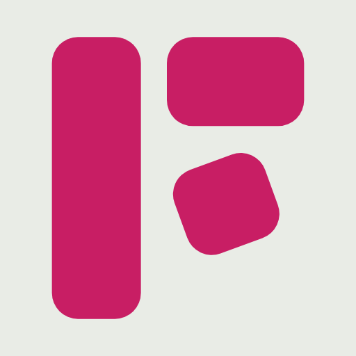

<p align="center"></p>

# Flett: the whiteboard your AI draws on

[Flett](https://flett.app) is a live, shared whiteboard. Connect it to Claude, ChatGPT, Cursor or Codex, ask for a diagram, a flowchart, a mind map, a deck or a document, and it lands on your board as real items: shapes and arrows you can move, notes you can edit, slides that export to PowerPoint and PDF. Everyone on the board watches it being drawn.

This repository holds:

- **The Flett MCP server config**: `https://flett.app/api/mcp`, streamable HTTP with OAuth sign-in. Nothing to install or host.
- **The `flett` skill** ([`skills/flett/SKILL.md`](skills/flett/SKILL.md)): when to use Flett, how to connect it, which tool fits which job, and recipes for architecture diagrams, flowcharts, mind maps, timelines and decks that read well.
- **A Claude Code plugin** that bundles both.

## Install

### Claude Code (plugin: skill and server together)

```
/plugin marketplace add AtheerAPeter/flett
/plugin install flett@flett
```

Then run `/mcp` and authenticate `flett`.

### Any agent with skills (Claude Code, Codex, Cursor, OpenCode and more)

```
npx skills add AtheerAPeter/flett
```

This installs the skill. Connect the server too, as below.

### Connect the server on its own

| App | How |
| --- | --- |
| Claude | Settings → Connectors → Add custom connector → `https://flett.app/api/mcp` |
| Claude Code | `claude mcp add --transport http flett https://flett.app/api/mcp`, then `/mcp` |
| ChatGPT | Settings → add a custom connector (MCP server) with the URL |
| Cursor | `.cursor/mcp.json`: `{ "mcpServers": { "flett": { "url": "https://flett.app/api/mcp" } } }` |
| Codex | `~/.codex/config.toml`: `[mcp_servers.flett]` with `url = "https://flett.app/api/mcp"`, then `codex mcp login flett` |

You sign in with a Flett account, Google or Microsoft the first time. Full guide: [flett.app/docs/mcp](https://flett.app/docs/mcp).

## Try asking

- "Read this repo and draw its architecture on a new Flett board."
- "Draw the signup flow of our app as a flowchart."
- "Turn these meeting notes into a mind map on my Planning board."
- "Make a five-slide deck about our Q3 results on Flett."
- "Map the places from this trip itinerary on a board."

## What it can draw

| | |
| --- | --- |
| Diagrams | Flowcharts, architecture and process diagrams, org charts, with arrows that follow the shapes they connect |
| Mind maps and boards | Sticky notes, frames and kanban columns, laid out for people to rearrange |
| Slides | One 16:9 sheet per slide, exportable to PowerPoint and PDF |
| Documents | Notes, reports, study guides and comparisons in markdown |
| Pages and charts | Designed HTML: landing pages, mockups, charts and cards |
| Maps | Places and routes on a real map |

## Pricing

Connecting and reading boards is free. A free account gets 50 board changes a day through MCP, and paid plans have no limit. Your AI app's own model does the drawing, so it spends none of your Flett allowance.

## Tools

`list_boards`, `create_board`, `read_board`, `read_block`, `draw`, `add_block`, `add_answer`, `add_map`, `upload_file`, `add_file`, `edit_block`, `update_block`, `set_text`, `move_items`, `delete_items`.

## Support

support@flett.app · [Privacy](https://flett.app/privacy)

## License

The skill and plugin files in this repository are MIT licensed. Flett itself is a hosted service.
